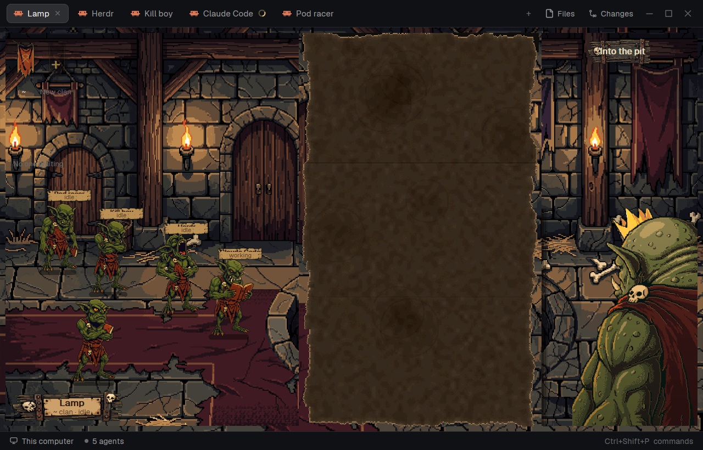

# Goblin King

A Herdr layout that turns your agents into a goblin court. Every agent tab is a goblin queueing in a torchlit
hall to petition you, the Goblin King. The goblin you're talking to stands in front of the throne, the rest wait
their turn, and the ones that need you push to the front.

## Install

Copy this repo's folders into your Herdr home (`~/.config/herdr-app`, on Windows
`C:\Users\<you>\.config\herdr-app`):

- `layouts/goblin-king.json` → `layouts/`
- every folder in `mods/` → `mods/`

Then switch to it: `herdr-app do layout.switch --name goblin-king`, or `ctrl-shift-l` until it shows. Your own
layout is untouched; `ctrl-shift-l` switches back.

Or ask an agent in Herdr: *"add the Goblin King layout from <repo link>"*.

## What it does

- **The court** (left): one goblin per agent, queued by need: blocked first, then done, working, idle. Each has a
  parchment name tag. Hover one and it gets excited; click it to call it forward.
- **Clans**: each Herdr space is a clan with its own banner colour. Click a banner to show only that clan (the
  others walk out the door); **+ New clan** starts a new space with a Claude agent.
- **The petitioner**: the focused tab's goblin stands before the throne with its nameplate. Its runts
  (sub-agents started with `hc run`) crouch at its feet; click a runt to step it forward.
- **Into the pit** (top right): throws the goblin in front into the pit and closes its tab, after a confirm.
- Goblins and runts are animated per status (idle, working, blocked, done, walking), and each agent keeps its own
  poses so neighbours don't match.

## Notes

- Built and tested on Windows with Herdr 0.1.14. Mac and Linux should work but haven't been tried.
- The hall scales to the window's height; wider windows give the terminal the extra room.
- The Files/Changes panel only opens when the window has room for it beside the court and the throne.
- Six clan colours; a seventh space reuses the first.
- "+ New clan" starts `claude` (Claude Code), so it expects that to be installed.

## Credits and licence

Goblin and King designs from Money Man (Grok), pixel art made with PixelLab and finished by hand-picked edits.
Code: MIT. Art (everything under `mods/goblin-court/art/`): all rights reserved, for use with this layout only.
See [LICENSE](LICENSE).
