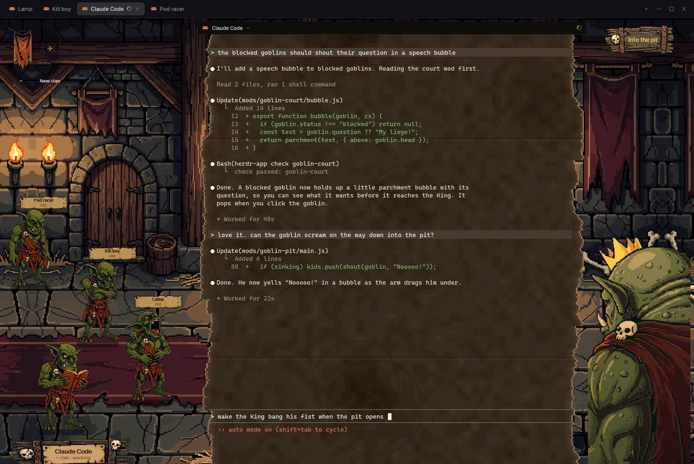

# Goblin King

Herdr as a goblin throne hall. Every agent is a pixel-art goblin queueing in a torchlit stone hall to petition
the person, who is the Goblin King: a huge over-the-shoulder King fills the right edge, the focused agent's
goblin stands before him with a parchment nameplate, and the terminal sits between them on a torn parchment page.

## What you see

- **Tab bar** (top, 42 px, `#0b0907e6`) and **status bar** (bottom, 28 px), the shipped `tabs` and
  `workspace-status`. The left sidebar is hidden.
- **Work row** (padding 8, gap 4), left to right:
  - **Court** (445 px, `goblin-court`): the hall's left side. Clan banners across the top (48x96 art px each,
    one per space, six colours: `#963c1e #3c4678 #285a3c #6e286e #484a52 #28646e`) and a "+ New clan" banner;
    "Waiting on you · N" under them. On the floor, the queue of goblins in a diagonal line from near the wall
    (back) to just behind the petitioner (front), each with a small parchment tag (name + status) over its head.
    Bottom left, the big nameplate (parchment nailed on planks with skulls) of the goblin in front.
  - **Terminal** (the rest, min 360 px): the active tab on a torn parchment page (`art/hall/torn-page.png`,
    cover).
  - **King's column** (237 px, `king-corner`): the hall's right side, an "Into the pit" plank button at the top,
    and the King (288x432 art px) at the bottom, spilling past the window edge.
- Every wall torch flickers, the extra ones in the end bays too: 8-frame GIFs of just the flame (transparent
  around it), its pixels repeated 4x so the app's smoothing leaves no edge.
- Everything is pixel art at the room's pixel scale: the hall is scaled to the window's height (the wide hall
  continues past both ends of the original on wide screens).

## How it behaves

- **One goblin per agent**, status as pose, each an 8-frame animated GIF: idle (standing; dozing in the queue),
  working (book, quill, counting), blocked (hands up, waving, clutching its head, plus an amber "!"), done,
  walking. Each agent keeps one pose variant per state (hash of its address); a goblin that would match the one
  just ahead of it takes the next variant.
- **Queue order**: blocked, done, working, idle; oldest change first. A goblin is as needy as its neediest runt.
- **Hover** a queued goblin (its own pixels, not its box): it plays an excited pose with an orange rim.
  **Click**: `agent.focus`, it walks up to the front; the dialogue curtain (`goblin-curtain`) unrolls over the
  terminal on arrival.
- **Banners**: click = show only that clan (other clans' goblins walk out through the hall's door, which opens)
  and `space.select`; click again to clear. "+ New clan" opens `goblin-prompt` and runs
  `space.new {name, argv: ["claude"]}`.
- **Runts** (terminals started by an agent with `hc run`): small animated crouching goblins in their parent's
  clan colour at its feet (three pose sets). Click one: `terminal.show`, it steps forward and its parent steps
  aside; click the parent to step back. A runt on Claude Code's "trust this folder?" prompt counts as blocked.
- **Into the pit**: `goblin-pit-confirm` (torn parchment dialog) → shared `goblin.pit` → the court opens
  `goblin-pit` as two borderless popups that redraw the whole scene. The petitioner walks to the pit's edge; the
  arm comes up out of the hole, strikes across the floor and grabs it, curves up, leans in over the hole, stands
  straight up holding it, then goes straight down into the pit; then `tab.close`. Each arm painting is a frame:
  hard cuts, never crossfades (~1.6 s from arrival to gone).

## Built from

- Layout `layouts/goblin-king.json`: root row (background `art/hall/goblin-hall-wide.png`, cover: the 1152x896
  hall continued 1152 px each side by mirrored end bays, so cover is a height fit on any window up to ~3.9:1 and
  every mod lines up with it exactly; the mods draw no hall of their own), hidden `sidebar`, `work` column:
  `tabs`, `work-body` row (`court` block → `goblin-court`, `main` tab block, `king-corner` block, hidden `panel`
  with `files`/`changes`), `status`.
- Mods: `goblin-court` (court, queue, banners, door, walks, nameplates, opens curtain and pit; all art in
  `art/`), `king-corner` (King, pit button, his torch), `goblin-curtain`, `goblin-pit`, `goblin-pit-confirm`,
  `goblin-prompt`.
- Herdr: `agents()`, `spaces()`, `terminals()`, `focused()`, `layout()`, `settings()`, `shared`/`setShared`
  (`goblin.px`, `goblin.cover`, `goblin.kingW`, `goblin.pit`), `openOverlay`, `run` (`agent.focus`,
  `space.select`, `space.new`, `terminal.show`, `tab.close`), `hc read` (trust prompt check), `readTextFile`
  (the art's JSON metadata), `window.viewport_size()` (live window size).
- Art: PixelLab (pixel art) from Money Man's Grok goblin designs; cleaned, torchlit and recoloured per clan by
  scripts; animated GIFs with one palette and a transparent key on every frame.

## Watch out

- Mods can't import each other's files: `layout-util.js` is copied into both `goblin-court` and `king-corner`.
- `local_position` in mouse events is in zoomed px; layout values are unzoomed: divide by `settings().zoom`.
- Popups' `at` is unzoomed while their `width`/`height` are zoomed.
- A `max` on a weighted block leaves empty space (it isn't given to the siblings): the court and King columns
  are fixed px and the terminal takes the rest.
- Art paths are relative to the Herdr home (`mods/goblin-court/art/...`); nothing lives in `backgrounds/`.
- The pit closes the thrown goblin's tab: test it on a throwaway tab.
- Herdr smooths scaled images: a transparent GIF edge blends toward black (a dark outline), and an opaque box
  holding a copy of the background sits a fraction of a pixel off it (its rectangle shows). Overlays carry only
  what changes, with pixels repeated (4x for the torches).
- The curtain's page is cover-fit, so taller than the terminal: "closed" must move it up by (h + page h) / 2,
  not h, or its bottom edge shows at the top.
- An image path is cached: a changed GIF needs a new file name.

## Done when

- Switching to `goblin-king` shows the hall, banners for every space, one animated goblin per agent and the King,
  with no errors in `herdr-app status`.
- Focusing another tab walks its goblin to the front and the nameplate shows its name.
- Hovering a queued goblin's body makes it excited; hovering the empty space beside it doesn't.
- A blocked agent's goblin moves to the front of the queue with its hands up.
- `hc run` from an agent puts an animated runt at its goblin's feet.
- Maximised on a 16:9 or ultrawide screen, the goblins and King keep their size and the terminal widens.
